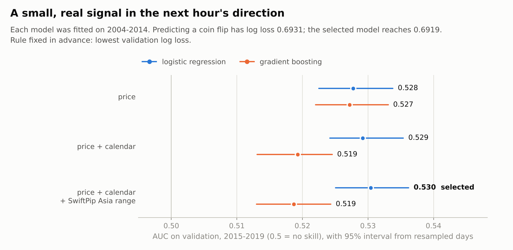
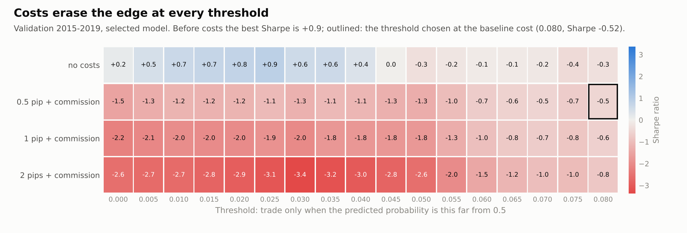
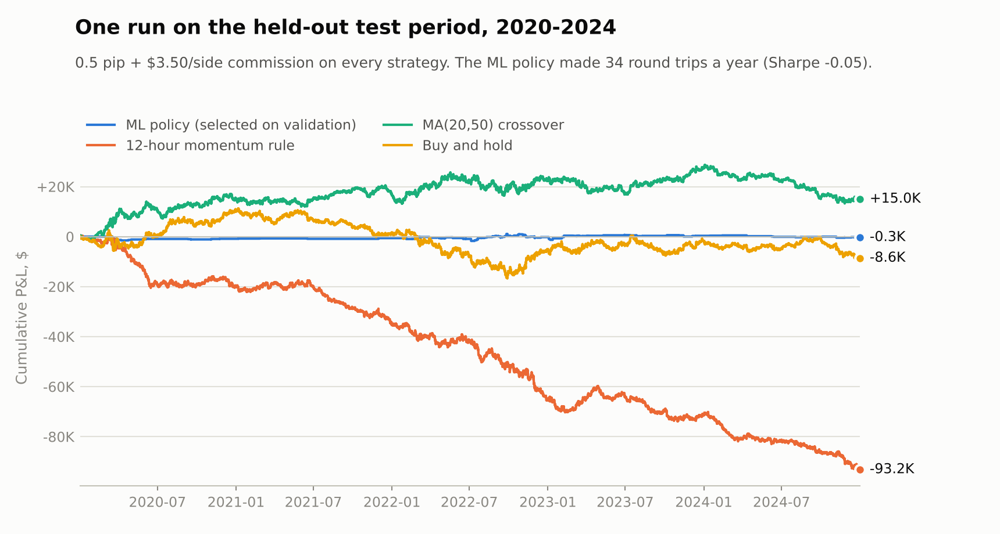
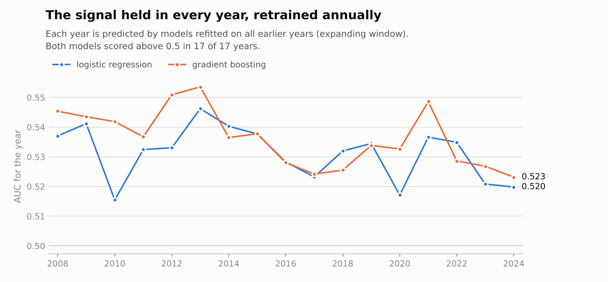
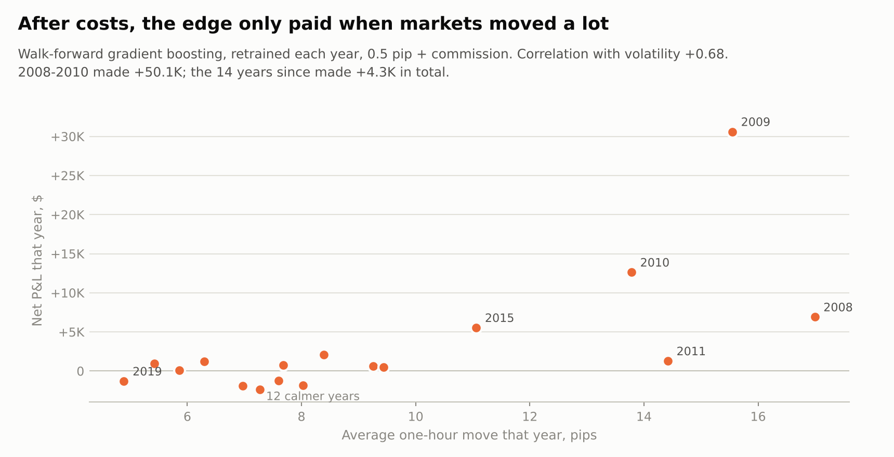

# ML trading research: can the next hour of EURUSD be predicted, and traded?

A supervised-learning pipeline that predicts the direction of the next hour of EURUSD from price, session and
SwiftPip Asia-range features, turns the predictions into positions, and backtests those positions through the
[C++ backtesting engine](../cpp-backtesting-engine) with spread and commission. The data is the EURUSD history
from the SwiftPip research: 21 years of HistData one-minute bid bars, used here as 129,913 hourly bars.

The answer, in short: **predictable, but not profitably.** The models find a small signal that holds out of
sample and in every year tested, and it is too small to pay for retail trading costs.

**At a glance**

- **A real but small signal.** Logistic regression trained on 2004-2014 scored an AUC of 0.524 on the held-out
  2020-2024 period (95% interval 0.519 to 0.531, resampling whole days), with 51.7% accuracy against a 50.3%
  base rate. Retrained each year, both models stayed above 0.5 in all 17 years from 2008 to 2024.
- **Costs erase it.** Before costs the best validation Sharpe was +0.87. After 0.5 pip plus $3.50 commission per
  side, every one of the 17 trading thresholds lost money on validation. The policy picked by rule then made
  -$349 over five years of test data, while a 12-hour momentum rule lost $93,212.
- **Simple beat complex.** Gradient boosting fitted the training years far better (AUC 0.62 against 0.54) and the
  validation years worse (0.519 against 0.530). Most of the signal is one-hour reversal: last hour's return,
  reversed, scores 0.522 on its own. The SwiftPip Asia-range features moved the logistic model from 0.529 to
  0.530, well inside the noise.
- **When it did pay.** Retrained yearly, gradient boosting made $50.1K after costs in 2008-2010, when the average
  hourly move was 14-17 pips, and $4.3K across the 14 years since. The edge grows with volatility; the cost of a
  trade does not.

## Contents

[Design](#design) · [Verification](#verification) · [Results](#results) · [What this means](#what-this-means) ·
[Limitations](#limitations) · [Run it](#run-it)

## Design

### Question

Does a supervised model predict the next hour's direction better than chance, and does that improve risk-adjusted
returns after costs compared with simple rules? Prediction and profit are scored separately, because a model can
be right more often than not and still lose money.

### Data and timing

- HistData EURUSD one-minute bid bars, 2004-01-01 to 2024-12-31, Eastern Standard Time without daylight
  saving, resampled to hourly bars by the engine repository's `python/prepare_data.py` (every row passes its
  checks). Hours with no trades are dropped, not filled.
- **Label.** A position decided at bar `t`'s close is filled by the engine at bar `t+1`'s open and can next
  change at bar `t+2`'s open, so the label is the sign of `open[t+2] - open[t+1]`: exactly the return the
  backtest earns. Exact ties (2.1% of hours) are left out of fitting and scoring but still traded through.
- **Periods.** Train 2004-2014, validation 2015-2019, test 2020-2024 (65,945 / 30,893 / 30,145 labelled hours).
  The last two hours of the train and validation periods are purged, because their labels use opens from the
  next period.

### Features

Every feature in row `t` uses only bars that have closed by `t`. That is tested, not assumed (see Verification).

| Group | Features |
|---|---|
| Price (9) | log returns over 1, 3, 12 and 24 hours; distance from the 30-hour average and between the 10- and 30-hour averages; 20-hour volatility and its ratio to 100-hour volatility; position in the 24-hour high-low range |
| Calendar (4) | session hour and weekday as sine/cosine pairs |
| SwiftPip Asia range (8) | from the SwiftPip research code: session clock EST+7, Asia range = session hours 2-9 (19:00-02:59 EST). Position of the close in the most recently completed Asia range, distances from its high and low and its width in 24-hour ATRs, whether London/NY has swept its high or low, and whether price closed back inside after the sweep |

### Models and selection rules

Logistic regression (standardised features) and histogram gradient boosting (200 trees, 15 leaves, at least
200 rows per leaf, fixed seed), each fitted on the three feature sets. Positions: one lot long when the
predicted probability of an up hour is above `0.5 + threshold`, one lot short below `0.5 - threshold`, flat in
between.

Both choices were made by rules fixed before the test period was run, and the result was written to
`results/selection.json` first:

1. Model and feature set: lowest validation log loss.
2. Threshold (0 to 0.08 in steps of 0.005): highest validation Sharpe at 0.5 pip plus commission, among
   thresholds that traded at least 100 times in validation.

Every backtest runs through the C++ engine (`bt_run --strategy file`), with the same rules as the engine
experiments: fills at the next open, bid quotes plus the spread on buys, $3.50 per side per 100,000 units,
100,000 units on $100,000, stop-out at zero equity.

## Verification

`tests/test_ml_trading.py` (9 tests, synthetic data shaped like HistData, so no download is needed):

- **No look-ahead, two ways.** Features computed on the full series must equal features computed on the series
  cut at row `t`, for several `t`. Multiplying every price after a given row by 1.5 must not change any feature
  before it.
- **Asia range by brute force.** For 300 random hours, the range used must be the latest session whose hours 2-9
  had all closed, and a bar in the middle of the Asia session must never see the range still forming.
- **Sweep flags by brute force**, label alignment against `open[t+2] - open[t+1]`, purging at period boundaries,
  the threshold policy, identical predictions from identical seeds.
- **Engine bridge.** A file of constant long targets gives the same P&L and fills as the engine's own
  buy-and-hold.

Two consistency checks fall out of the results: the MA(20,50) and buy-and-hold test-period numbers match the
engine repository's own experiments to the cent, and re-running the whole pipeline reproduces every number.

## Results

### Prediction (models fitted on 2004-2014)

<picture>
  <source media="(prefers-color-scheme: dark)" srcset="results/figures/model_auc_dark.png">
  
</picture>

| Model | Features | Train AUC | Validation AUC (95% interval) | Validation log loss |
|---|---|---:|---:|---:|
| Logistic regression | price | 0.536 | 0.528 (0.523-0.534) | 0.69216 |
| Gradient boosting | price | 0.608 | 0.527 (0.522-0.533) | 0.69306 |
| Logistic regression | price + calendar | 0.536 | 0.529 (0.524-0.535) | 0.69202 |
| Gradient boosting | price + calendar | 0.616 | 0.519 (0.513-0.525) | 0.69491 |
| **Logistic regression** | **+ SwiftPip Asia range** | 0.537 | **0.530 (0.525-0.536)** | **0.69186** |
| Gradient boosting | + SwiftPip Asia range | 0.621 | 0.519 (0.513-0.524) | 0.69501 |

For scale: always predicting the training up-share gives log loss 0.69313. Last hour's return, reversed, gives
an AUC of 0.522 by itself; the 12-hour return used as a momentum score gives 0.482, so momentum at this horizon
points the wrong way.

On the test period the selected model scored AUC 0.524 (0.519-0.531) and accuracy 51.7% (51.2%-52.2%) against
an up-share of 50.3%.

### Trading thresholds and costs (validation, selected model)

<picture>
  <source media="(prefers-color-scheme: dark)" srcset="results/figures/threshold_cost_dark.png">
  
</picture>

Trading on every prediction means about 1,360 trades a year, nearly all of them flips from long to short or back.
Before costs that earns +$7.5K over the five validation years, and the best threshold (0.025) earns +$28.8K with
a Sharpe of +0.87. At 0.5 pip plus commission, every threshold loses: from -$74.2K at threshold 0 to -$5.5K at
0.08, where the policy makes 39 round trips a year. The rule therefore picked 0.08, the largest threshold tested.
In other words, the best the policy could do after costs was to trade as little as possible.

### The test period, after the choices were fixed

<picture>
  <source media="(prefers-color-scheme: dark)" srcset="results/figures/test_period_dark.png">
  
</picture>

| Strategy | Net P&L | Sharpe | Worst drawdown on capital | Round trips a year |
|---|---:|---:|---:|---:|
| ML policy (logistic, all features, threshold 0.08) | -$349 | -0.05 | -2.4% | 34 |
| 12-hour momentum rule | -$93,212 | -2.17 | -94.1% | 428 |
| MA(20,50) crossover | +$15,004 | +0.35 | -15.5% | 66 |
| Buy and hold | -$8,598 | -0.20 | -28.0% | 0 |

The policy was in the market 0.6% of the time. It earned about $1,700 before costs and paid $2,064 in spread and
commission. Afterwards, for diagnosis only, every threshold was run on the test period too: all of them made
money before costs (between +$1.5K and +$52.5K), and after costs only one ended above zero (+$528).

### Walk-forward: retraining every year

<picture>
  <source media="(prefers-color-scheme: dark)" srcset="results/figures/walk_forward_auc_dark.png">
  
</picture>

Each year from 2008 to 2024 was predicted by models refitted on every earlier hour. Both stayed above 0.5 in all
17 years (lowest: 0.515). With fresh data every year, gradient boosting beat logistic regression in 12 of the 17
years, even though the version fitted once on 2004-2014 had done worse on 2015-2019. That points to a pattern
that drifts: a flexible model helps when it is kept up to date, and goes stale faster when it is not.

<picture>
  <source media="(prefers-color-scheme: dark)" srcset="results/figures/volatility_dark.png">
  
</picture>

Trading the yearly gradient-boosting predictions at the 0.08 threshold made $54.5K after costs over 17 years,
but $50.1K of it came in 2008-2010, when the average hourly move was 14-17 pips. Since 2016 the average move has
been 5-9 pips, and the same policy has lost $6.4K over those nine years. Profit and volatility have a
correlation of 0.68 across the years. These walk-forward runs came after the test evaluation and changed nothing in it; the
threshold was chosen for the logistic model, so treat them as a description, not a strategy.

## What this means

The hourly direction of EURUSD is predictable to a small, measurable degree, mostly through short-term
reversal, and the signal has held for 17 years. It is not tradable at retail costs. Traded on every prediction,
it earned $7.5K before costs over the five validation years and $42.5K over the five test years, while the
spread and commission on the same trades came to about $80K each time. Waiting for confident predictions cut
the trading but did not raise the edge per trade enough to cover the cost. A strategy built on this signal
would need much cheaper execution, or a way to trade only when moves are large, which is the next thing to test.

## Limitations

- **One instrument, one horizon, bar data.** Fills at the next hourly open; no intrabar execution, order book or
  latency. Spread is fixed for all 21 years and the ask is approximated as bid plus that spread.
- **A small search, still a search.** Six model and feature combinations and 17 thresholds were tried on
  validation. The chosen threshold sat at the edge of the grid; extending the grid after seeing the test period
  would have made the test meaningless, so it was not done.
- **Intervals** resample whole days, which handles correlation within a day but not across days.
- **Walk-forward profits** use a threshold chosen for a different model and are reported as a description.
- **No financing, no position sizing.** Overnight swap is not modelled; every position is one lot.

## Run it

Needs the C++ engine built (Release) and its hourly data prepared, in a folder next to this one:

```bash
# in ../cpp-backtesting-engine
cmake -S . -B build -DCMAKE_BUILD_TYPE=Release && cmake --build build --config Release
python python/prepare_data.py --pickle path/to/HD_EURUSD_1min_2004-2024.pkl

# here
python -m pip install -r requirements.txt
python -m pytest tests                       # 9 tests, about 5 seconds
python ml_trading.py                         # every experiment, about one minute -> results/experiments.json
python make_figures.py                       # results/figures/*.png
```

`BT_ENGINE_REPO`, `BT_BUILD_DIR` and `ML_DATA` override the default locations. All settings (periods, costs,
thresholds, model parameters, seed) are in the config block at the top of `ml_trading.py`. Package versions used
for the results: Python 3.13, NumPy 2.5, pandas 3.0, scikit-learn 1.9.

```
ml_trading.py        config block, features, labels, splits, models, policy, engine bridge, experiments
make_figures.py      charts from results/experiments.json
tests/               leakage, labelling, policy and engine-bridge tests
results/             experiments.json, selection.json (written before the test run), figures
```
